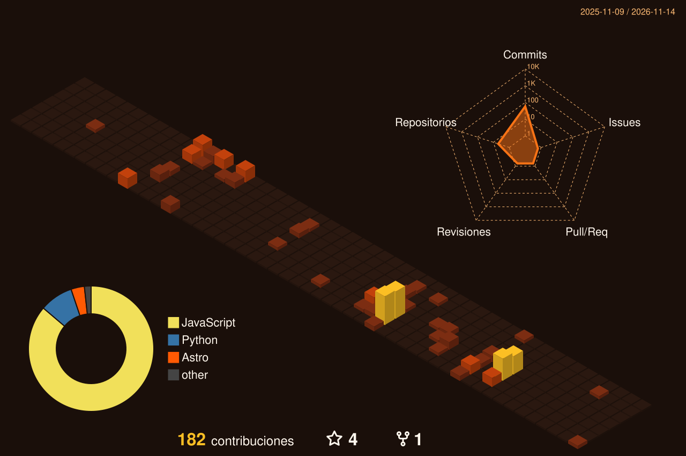

  
  

Soy desarrollador multiplataforma especializado en **IA generativa** (RAG y LLMs) y en despliegue **cloud**. Vengo también del lado del hardware: electrónica, microcontroladores, Raspberry Pi y reparación de equipos. Trabajo en Linux a diario.

## Experiencia

**Consultor TI · Castroalonso** (Gijón) · 2025 – 2026

- Desarrollé **DATA-X**, una plataforma de IA con RAG y LLMs desplegada en AWS.
- Implanté un ERP con **Dolibarr** y automaticé procesos internos.
- Gestioné máquinas virtuales (**Proxmox**, **VMware**), me encargué de la ciberseguridad e hice pentesting de caja negra.

**Electrónica y soporte técnico**

- Montaje y soldadura de componentes, y proyectos con microcontroladores y Raspberry Pi.
- Diagnóstico y reparación de equipos con Windows y Linux.

## Proyectos

| Proyecto | Descripción | Tecnología |
|:--|:--|:--|
| [**DATA-X**](https://datax.castroalonso.com) | Cumplimiento normativo con un motor RAG propio y un cliente LLM multimodelo (Claude, Gemini, Llama, DeepSeek). | Python/FastAPI · Java/Quarkus · React · AWS |
| [**GameS**](https://zenithseed.dev/projects/games) | Proyecto de fin de curso: plataforma para descubrir videojuegos, con búsqueda avanzada e historial de precios. [Código](https://github.com/alvarosac99/GameS) | JavaScript |
| [**fish**](https://github.com/alvarosac99/fish) | Mi configuración de Fish shell: prompt Tide, eza, bat, duf, fzf y plugins de productividad. Incluye una guía de instalación para Arch, Ubuntu, Debian y Fedora. | Fish · Shell |
| [**Porfolio-2026**](https://github.com/alvarosac99/Porfolio-2026) | Mi porfolio profesional. | Astro |

## Tecnologías

También trabajo con RAG, LLMs y fine-tuning, y con Quarkus, Proxmox y VMware.

## Formación

- **FP Superior en Desarrollo de Aplicaciones Multiplataforma**, IES Doctor Fleming, Oviedo (2023–2025)
- **CCN-CERT: Auditorías en el ENS y seguridad TIC** (2026)

## Actividad

<picture>
  <source media="(prefers-color-scheme: dark)" srcset="https://raw.githubusercontent.com/alvarosac99/alvarosac99/output/github-snake-dark.svg"/>
  <source media="(prefers-color-scheme: light)" srcset="https://raw.githubusercontent.com/alvarosac99/alvarosac99/output/github-snake.svg"/>
  
</picture>
